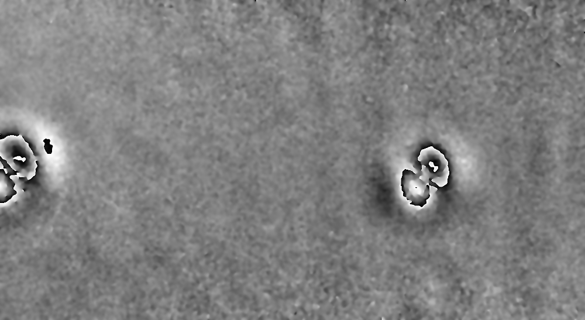

# EfficientAD – Extended and Refactored Implementation

This project provides a clean, extensible, and reproducible EfficientAD pipeline suitable for academic research and industrial experimentation.

It builds upon the unofficial EfficientAD implementation by [nelson1452](https://github.com/nelson1425/EfficientAD), restructuring and extending the original codebase to improve:

- modularity and maintainability  
- configuration management  
- experiment reproducibility  
- evaluation and output analysis  

The implementation is based on the 2023 paper:

> *EfficientAD: Accurate Visual Anomaly Detection at Millisecond-Level Latencies* (WACV 2024)

[](https://openaccess.thecvf.com/content/WACV2024/papers/Batzner_EfficientAD_Accurate_Visual_Anomaly_Detection_at_Millisecond-Level_Latencies_WACV_2024_paper.pdf)
[](https://github.com/nelson1425/EfficientAD)


## Features
- Unsupervised anomaly detection using EfficientAD  
- Training on normal samples only  
- Modular project structure with YAML-based configuration  
- Unified CLI for training, evaluation, and inference  
- Image-level anomaly scoring and analysis  
- Pixel-level heatmaps, binary mask overlays, and LabelMe-compatible polygon annotations  


## Demo
Example results on shearography images showing pixel-level anomaly detection outputs.  
Image rights: Plaßmann et al., https://zenodo.org/records/17631257

<table>
  <tr>
    <th align="left">Input</th>
    <th align="left">Ground Truth</th>
    <th align="left">Heatmap</th>
    <th align="left">Binary Mask</th>
  </tr>

  <tr>
    <td></td>
    <td></td>
    <td></td>
    <td></td>
  </tr>

  <tr>
    <td></td>
    <td></td>
    <td></td>
    <td></td>
  </tr>

  <tr>
    <td></td>
    <td></td>
    <td></td>
    <td></td>
  </tr>
</table>


## Table of Contents
* [Installation](#installation)
* [Project Structure](#project-structure)
* [Dataset Structure](#dataset-structure)
* [Configuration](#configuration)
* [CLI Usage](#cli-usage)
* [License](#license)


## Installation

### Requirements
- **Python:** 3.10 or newer  
  (Tested with Python 3.10.12 and 3.12)

- **Hardware (recommended):** CUDA-enabled GPU with >4 GB VRAM  
  (Tested on NVIDIA Quadro P2000 Mobile and RTX 3060 Ti)

- **Python packages:** Listed in `requirements.txt`


### Create and activate a virtual environment
```bash
python3 -m venv .efficientad_venv
source .efficientad_venv/bin/activate
```

### Install dependencies
```bash
pip install -r requirements.txt
```

> **Note:** The project was tested with PyTorch 1.13.1 + CUDA 11.6.  
> If your system uses a different CUDA version, adjust the `torch` and `torchvision` versions accordingly.


## Project Structure
```text
efficient_ad/
├── assets/                   # Demo images used in the README
├── configs/                  # YAML configuration files
├── datasets/                 # Dataset storage
├── output/                   # Outputs from training, evaluation, and inference
├── pretrained/               # Pretrained teacher models
├── src/
│   ├── data/                 # Dataset handling
│   ├── evaluation/           # Evaluation pipeline
│   ├── inference/            # Inference pipeline and visualizations
│   ├── models/               # Model architectures (PDN, Autoencoder)
│   ├── pretraining/          # Teacher pretraining pipeline
│   ├── scripts/              # CLI entry points
│   ├── training/             # EfficientAD training pipeline
│   └── utils/                # Shared utilities
├── README.md                 # Project documentation
├── requirements.txt          # List of required Python packages
└── THIRD_PARTY_LICENSES      # Third-party licenses and source attributions
```


## Dataset Structure
Datasets are stored in the `datasets/` directory and follow a standard anomaly-detection layout with separate `train`, `test`, `val`, and `ground_truth` subdirectories.

The `train` split must contain **only normal samples**.  
The `test` and `val` splits may contain both normal and faulty samples.

The names of the normal class subdirectories (e.g. `good`) can be configured in the corresponding YAML configuration file. All subdirectories that do not match the configured names for normal classes are treated as defect classes during evaluation.

Ground-truth annotations are provided as **binary masks** (white = anomaly, black = normal).  
Each mask must share the same filename as its corresponding faulty image.


### Example Directory Structure

```text
datasets/
└── <dataset_name>/
    ├── train/
    │   └── good/
    ├── test/
    │   ├── good/
    │   └── faulty/
    ├── val/
    │   ├── good/
    │   └── faulty/
    └── ground_truth/
        └── faulty/
```


## Configuration
All pipelines are configured via YAML files located in the `configs/` directory.  
These configuration files should be reviewed and adapted before executing any of the CLI scripts.

If a parameter is specified both in the configuration file and via a command-line argument, the CLI argument takes precedence.

Two separate configuration files are provided:

- `efficientad.yaml`  
  Configuration for EfficientAD training, evaluation, and inference.

- `pretraining.yaml`  
  Configuration for training (pretraining) the teacher network.


## CLI Usage
All entry-point scripts are executed as Python modules.
If no command-line arguments are provided, values defined in the configuration file are used as defaults. CLI arguments always override configuration values.


### Training
Trains the EfficientAD model on normal samples of a dataset.

```bash
python3 -m src.scripts.train_efficientad
```

**Arguments:**
- `-c`, `--config CONFIG`  
  Path to the configuration file (YAML).


### Evaluation
Evaluates a trained EfficientAD model on unseen data with ground-truth annotations.
Computes image-level and pixel-level metrics and optionally saves anomaly maps and visualizations.

```bash
python3 -m src.scripts.evaluate
```

**Arguments:**
- `-c`, `--config CONFIG`  
  Path to the configuration file (YAML).
- `-ch`, `--checkpoint CHECKPOINT`  
  Path to the trained EfficientAD checkpoint.
- `-d`, `--dataset DATASET`  
  Path to the dataset root directory (e.g. MVTec test folder).
- `-o`, `--output-dir OUTPUT_DIR`  
  Custom root directory for outputs.
- `--save-only-metrics`  
  Disable saving heatmaps, region overlays and polygon annotations.
- `--save-component-maps`  
  Save individual EfficientAD anomaly maps (combined, student-teacher, autoencoder).


### Inference
Runs batch inference with a trained EfficientAD model on unseen data without ground-truth annotations.
Generates anomaly maps, heatmap overlays, region overlays, and image-level anomaly scores.

```bash
python3 -m src.scripts.infer
```

**Arguments:**
- `-c`, `--config CONFIG`  
  Path to the configuration file (YAML).
- `-ch`, `--checkpoint CHECKPOINT`  
  Path to the trained EfficientAD checkpoint.
- `-d`, `--dataset DATASET`  
  Path to the dataset root directory (e.g. MVTec test folder).
- `-o`, `--output-dir OUTPUT_DIR`  
  Custom root directory for outputs.
- `--save-component-maps`  
  Save individual EfficientAD anomaly maps (combined, student-teacher, autoencoder).


### Teacher Training
Trains the teacher network (feature extractor) used by EfficientAD.

```bash
python3 -m src.scripts.train_teacher
```

**Arguments:**
- `-c`, `--config CONFIG`  
  Path to the configuration file (YAML).


### Help
Each script provides a detailed help message:

```bash
python3 -m src.scripts.<script_name> --help
```


## Third-Party Licenses

This repository includes code derived from the unofficial EfficientAD implementation by [nelson1425](https://github.com/nelson1425/EfficientAD), which is licensed under the Apache License 2.0.

It also includes portions of the AUPRO evaluation code derived from the MVTec AD evaluation project, which are licensed under the BSD 3-Clause License. The original project is available on the [official MVTec AD website](https://www.mvtec.com/research-teaching/datasets/mvtec-ad).

The complete license texts and source attributions for all included third-party components are provided in `THIRD_PARTY_LICENSES`.